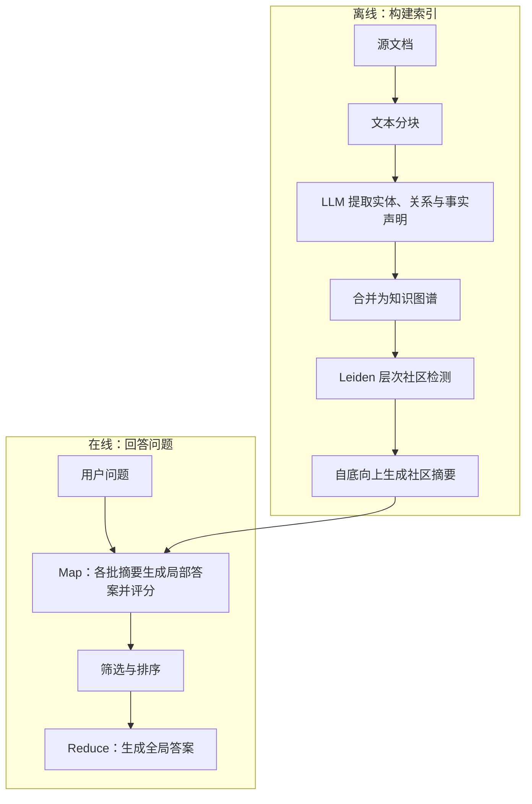

# 论文分析

https://microsoft.github.io/graphrag/

# Paper

==🟠**arxiv: 2404.16130**==

这篇 GraphRAG 论文的 Method 核心是：**先把整个语料库转化为知识图谱，再生成分层社区摘要；收到问题后，用 Map–Reduce 汇总出全局答案。** 它主要解决“整个数据集有哪些主题、趋势或共同观点”这类需要全局理解的问题。

依据论文第 3 节 Methods 和图 1：C:/Users/cjw/Downloads/2404.16130.pdf

**1. 从文档构建知识图谱（§3.1.1–3.1.3）**

先把文档切成文本块，让 LLM 从每块中提取：

- **实体**：人物、组织、地点等，并生成描述。
- **关系**：实体之间的联系，并生成关系描述。
- **事实声明（claims，可选）**：与实体有关的日期、事件等信息。

同一个实体或关系可能在多个文本块中重复出现，因此需要合并，并让 LLM 汇总其描述。最终实体成为节点、关系成为边；**关系重复出现的次数作为边权重**。论文实验使用精确字符串匹配来合并实体。

分块大小需要权衡：块越大，调用次数和成本越低，但可能遗漏更多信息。

**2. 将图划分为层次社区（§3.1.4）**

用 **Leiden 社区检测**把联系紧密的实体聚到一起，再递归划分子社区，形成从粗到细的层次结构。

这里的“社区”是关系紧密的一组实体，可以承载一个主题或子主题。同一层的社区互不重叠，并共同覆盖图中的节点，因此可以把全局总结拆成多个局部任务。

**3. 预先生成社区摘要（§3.1.5）**

摘要在用户提问之前生成，可以供不同问题复用。

- **叶子社区**：根据实体、关系和 claims 生成摘要。内容超出上下文时，优先加入连接度较高的实体及其关系。
- **上层社区**：内容能放下就直接总结；超出上下文时，逐步用较短的子社区摘要替代详细信息，再生成上层摘要。

这样得到不同粒度的索引：上层摘要更概括，下层摘要更详细。

**4. 围绕问题执行 Map–Reduce（§3.1.6）**

选定一个社区层级后，处理该层的社区摘要：

1. **准备输入**：随机打乱摘要，按 token 预算组成若干批次，分散相关信息。
2. **Map**：LLM 并行读取各批摘要，针对问题生成局部答案，同时给出 **0–100 的有用性评分**；过滤评分为 0 的答案。
3. **Reduce**：按评分从高到低，将局部答案加入最终上下文，直到达到 token 上限，再生成全局答案。

需要区分：**社区摘要是预先生成的通用描述；局部答案是收到问题后生成的针对性回答。**

**5. Method 还包含评估设计（§3.2–3.3）**

作者根据语料库的简短描述，让 LLM 依次生成“潜在用户 → 用户任务 → 全局问题”。每个数据集生成 \(5×5×5=125\) 个问题。

由于没有标准答案，采用 LLM 两两比较系统输出，评估：

|指标|关注什么|
|---|---|
|全面性|是否覆盖问题的各个方面|
|多样性|是否提供丰富的视角和见解|
|判断支持（Empowerment）|是否帮助读者理解并作出判断|
|直接性|是否清晰、具体地回应问题，作为对照指标|

**关键创新在于把图的社区结构用作分层摘要的组织依据。** 图连接跨文档的信息，社区摘要将其压缩成可复用的主题材料，Map–Reduce 再把这些材料组织成针对问题的全局回答。其代价是前期抽取与摘要成本，以及多次压缩可能丢失细节。